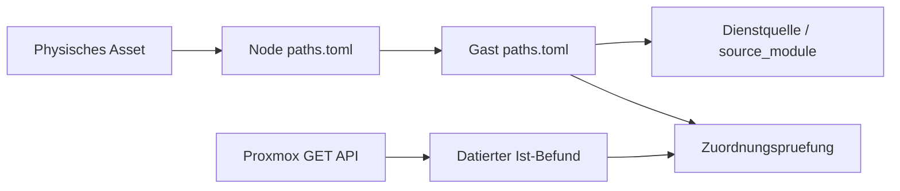

# Physische Architektur und digitaler Zwilling

Stand: 21.10.2026. Lesende Live-Pruefung; keine Cluster-Konfiguration geaendert.
Messzeitpunkt und Rohbefunde:
[Cluster-Audit](assets/cluster-audit-2026-10-21.json).

## Entscheidung

Nicht noch eine manuell gepflegte VM-Tabelle und vorerst kein zusaetzliches
CMDB-System. Die bestehende Pfadbibliothek ist bereits der Kern eines kleinen
digitalen Zwillings:



- [physical.toml](physical.toml): stabile Asset-IDs, Hardware und physische
  Abhaengigkeiten.
- [Root-Manifest](../paths.toml): aufloesbare Modulpfade, keine zweite
  VM-Datenbank.
- Node-Manifeste: Proxmox-Name und Management-IP.
- Gast-Manifeste: VMID/CTID, Node, dokumentierte Adresse, Diensttyp und
  Quellverweis.
- [cluster_audit.py](cluster_audit.py): verknuepft diese Daten und vergleicht
  sie mit Proxmox.
- Beobachtungen bleiben getrennt von Deklarationen. Migrationen werden gemeldet,
  nicht still in Soll-Daten uebernommen.

Asset-IDs wie `compute_ug` sind Inventarschluessel, keine Seriennummern. Nach
physischer Kennzeichnung sollten sie am Gehaeuse stehen. Standort, Steckdose/USV
und Switch-Port sind bewusst `unknown`: Ein Hostname beweist keine Etage. Ein
Hardwaretausch erzeugt kuenftig ein neues Asset; ein Node-Umzug nicht.

## Verifizierter Cluster

`brainhome`: fuenf Nodes online, fuenf Stimmen, Quorum drei, Transport knet. Am
21.10.2026 waren 25 Gaeste (16 VMs, neun LXCs) erfasst; die damalige
Platzierung und fuenf Management-IPs passten zum Live-Bestand. Eine erneute
Live-Abfrage am 23.10.2026 ergab 27 Gaeste (18 VMs, neun LXCs), davon 21 running
und sechs stopped. Darin enthalten ist der temporaere Restore-Test VM190. IPs
der Gaeste stammen aus Manifesten, nicht aus einem Netzscan.

| Node       | Management-IP   | CPU live                          | RAM nutzbar | RAM benutzt | PVE    |
| ---------- | --------------- | --------------------------------- | ----------- | ----------- | ------ |
| proxmox-eg | 192.168.188.253 | Intel i7-9700, 8 Threads          | 31,2 GiB    | 31 %        | 9.2.10 |
| proxmox-og | 192.168.188.252 | Intel i7-9700, 8 Threads          | 31,2 GiB    | 30 %        | 9.2.10 |
| proxmox-ug | 192.168.188.248 | AMD FX-8350, API meldet 4 Threads | 23,4 GiB    | 74 %        | 9.2.10 |
| proxmox-ws | 192.168.188.247 | Ryzen 7 3800X, 16 Threads         | 31,3 GiB    | 86 %        | 9.2.10 |
| proxmox-dt | 192.168.188.133 | Ryzen 5 3600, 12 Threads          | 15,5 GiB    | 82 %        | 9.1.1  |

RAM-Werte sind eine Momentaufnahme inklusive Host-/Cache-Effekten, keine
Langzeitmessung. WS nutzt zusaetzlich etwa 4,1 GiB Swap; Ursache und aktive
Swap-I/O vor einer RAM-Aenderung messen. EG/OG sind Lenovo-DMI-Produkte
`10RRS1F802` / `10RS0033MX`; UG ist Gigabyte `GA-990FXA-UD3`, WS MSI `MS-7C37`.
Nicht ungeprueft als M920q/Tiny oder T-CPU klassifizieren.

| Node | VMs                                                                                               | LXCs                                                     |
| ---- | ------------------------------------------------------------------------------------------------- | -------------------------------------------------------- |
| EG   | 102 haos-eg, 108 openwrt-eg                                                                       | 114 pihole-eg, 117 caddy-eg                              |
| OG   | 103 haos-og, 109 openwrt-og                                                                       | 111 pihole-og, 120 caddy-og                              |
| UG   | 106 haos-ug, 115 haos-ga, 119 openwrt-ug, 219 grafana                                             | 100 pihole, 110 caddy, 116 brainhome-prod, 130 pxe-stack |
| WS   | 101 haos, 113 ubuntu-pc, 220 windows-stefan (gestoppt)                                            | 112 brainhome-dev (gestoppt)                             |
| DT   | 104 Vaultwarden, 105 Stalwart, 107 Keycloak, 118 PBS, 121 Nextcloud, 180 Coral (gestoppt) | keine |

Der alte Host `.254` ist kein aktuelles Mitglied. Die im Maerz geplanten vier
neuen UG-Tinys sind kein Abbild dieses Bestands. WS ist bereits Ryzen, nicht FX.

VM118 `pbs-dt` laeuft auf `proxmox-dt`; das Gastmanifest ist
`proxmox-dt/vms/pbs-dt/paths.toml`. Der gestoppte Restore-Test VM190 ist
temporaer und kein Produktionsgast.

## PBS- und Backup-Nachtrag 2026-10-23
## PBS- und Backup-Nachtraege 2026-10-23 / 2026-10-26

- PBS 4.2.0 laeuft als VM118 auf `proxmox-dt`; der QEMU-Gastagent ist aktiv.
- Das Datastore `pbs-dt` liegt auf DT-lokalem ZFS. Es ist ein vom BrainCloud-NAS
   unabhaengiges Backup-Ziel, aber kein zweiter physischer oder externer Host.
- HA-VMs 102, 103 und 106 liegen weiterhin auf dem BrainCloud-NFS
   `shared-storage`; ihre Sicherungen lesen deshalb weiterhin von diesem NAS.
- Initiale PBS-Backups und PBS Verify sind fuer EG, OG und UG erfolgreich. Der
   Restore-Test von OG nach VM190 ist abgeschlossen; VM190 bleibt gestoppt und
   `onboot=0`.
- Die erste taegliche PVE-Runde schrieb alle drei Snapshots, meldete aber
   `job errors`, weil dem privilege-separated PBS-Token `Datastore.Prune` fehlte.
   User und Token haben nun `DatastorePowerUser` nur auf `/datastore/pbs-dt`,
   ohne `Datastore.Modify`. Ein einzelner UG-Test mit `keep-last=7` endete `OK`
   und entfernte null Backups; die naechste taegliche Runde muss die Korrektur
   fuer alle drei Gaeste bestaetigen.
- Die beiden BrainCloud-NFS-Backupjobs sind deaktiviert, nicht geloescht. Sie
   deckten auch Nicht-HA-Gaeste ab; fuer diese ist noch keine PBS-Ersatzabdeckung
   eingerichtet.
- Stand 26.10.2026 sind fuenf HAOS-VMs im PVE-HA-Manager registriert und
   `started`: 101 auf WS sowie 102 auf EG, 103 auf OG, 106 und 115 auf UG. Der
   PBS-Job sichert weiterhin nur 102, 103 und 106; 101 und 115 sind nicht in
   diesem Job enthalten.

## Risiken nach Prioritaet

1. **Wiederherstellbarkeit vor Ausbau.** Die beiden alten NFS-Jobs sind
   deaktiviert; PBS deckt derzeit nur HA-VMs 102, 103 und 106 ab. Die pausierten
   NFS-Jobs enthielten auch Nicht-HA-Gaeste, fuer die noch keine automatisierte
   Ersatzabdeckung besteht. Separate HA-/Applikationsbackups sind nicht
   bewertet.
2. **NAS und gemeinsame Backup-Fehlerdomaene.** `backup-daily`,
   `backup-monthly` und `shared-storage` verweisen auf dasselbe BrainCloud-NAS
   `.42`; beide RAID1-Arrays liefen laut Betreiberkonsole nur mit einem
   Mitglied. Das gesunde Datenmitglied ist `WDC WD40EFRX-68WT0N0` (4 TB).
   WD Red Plus `WD40EFPX` (4 TB) ist bestellt, aber noch nicht geliefert oder
   eingebaut; My-Cloud-Modell und Herstellerkompatibilitaet vor Einbau klaeren.
   Kauf/Rebuild ersetzt keine unabhaengige Datensicherung. Rund 3,50 TB von
   3,93 TB belegt, etwa 89 %; Storage-Anzeigen nicht addieren.
   `backup-monthly` laeuft sonntags, nicht monatlich. PBS liegt inzwischen auf
   DT-lokalem Storage; die HA-Quellplatten bleiben jedoch auf dem NAS. Ein
   unabhaengiges/offline Ziel und weitere Restore-Tests bleiben erforderlich.
3. **HA ist selektiv.** VM101, VM102, VM103, VM106 und VM115 sind PVE-HA-
   verwaltet. Der konfigurierte Replikationsjob deckt nur VM102 von EG nach OG
   ab; HA-Ressourcenstatus ist keine Datenreplikation oder Backup-Abdeckung.
   Storage-Erreichbarkeit, CPU-Modell, Passthrough und Netzabhaengigkeiten pro
   Gast vor Failover testen. Corosync-Quorum bedeutet weder Dienst-HA noch
   Datenredundanz.
4. **Kapazitaet ungleich verteilt.** Erst WS-Speicherdruck messen und DT-RAM
   planen. EG/OG haben Reserve, aber diese nicht durch beliebige Verschiebungen
   kritischer Infrastruktur aufbrauchen. Intel-/AMD-Mischbetrieb und lokale
   Geraetebindungen verhindern pauschale Live-Migrationsversprechen.
5. **Versionsstand angleichen.** DT meldet PVE 9.1.1 / Kernel 6.17.2-1-pve, die
   vier anderen 9.2.10 / 7.0.14-11-pve. Wartungsfenster erst nach Backups und
   Release-/Kompatibilitaetspruefung; kein automatisches Upgrade.
6. **Widerspruechliche Planungen.** Alte Dokumente verwenden verschiedene
   VLAN-Nummern. Keine davon ungeprueft ausrollen. Zuerst IPAM/VLAN-Entscheidung
   festhalten. MAC-Zuweisung ist keine verlaessliche Identitaet; dynamische
   VLANs brauchen passende hostapd/RADIUS-/AP-Konfiguration. Eine SSID aendert
   man nicht fern durch blosses Zuweisen am Server.
7. **Zugangsdaten in Dokumentation.** Die Infrastruktur-Uebersicht enthaelt
   Zugangsdaten/Secrets. Als potenziell offengelegt behandeln, kontrolliert
   rotieren und anschliessend durch Secret-Referenzen ersetzen. Nicht in den
   digitalen Zwilling uebernehmen.

## Betrieb und Grenzen

Python 3.11+ mit Standardbibliothek; kein Paket und kein zusaetzlicher Dienst.
Vom Workspace-Root aus mit dem konfigurierten Interpreter ausfuehren:

```bash
python3 architektur/cluster_audit.py
python3 architektur/cluster_audit.py --live proxmox-ug --output /tmp/brainhome-audit.json
python3 architektur/cluster_audit.py --observed architektur/assets/cluster-audit-2026-10-21.json
python3 -m unittest discover -s architektur -p 'test_cluster_audit.py'
```

Fuer den Offline-Vergleich akzeptiert `--observed` den gesamten Bericht oder nur
dessen `observed`-Objekt. Exitcode 0: keine Platzierungsdrift; 1: Drift; 2:
Fehler. Backup-Luecken sind Befunde im JSON und kein Drift-Exitcode. Ohne
Live-Option findet ausschliesslich lokale Validierung statt. SSH nutzt
BatchMode, bekannte Hostschluessel und ausschliesslich `pvesh get`; keine
Agent-Ausfuehrung, Migration, Restart, Cron-Aenderung oder
Hostschluessel-Uebernahme.

Der vorhandene [Inventar-Export](../tools/config/infrastructure-inventory.md)
hatte bei der Erstpruefung leere Node-/Gastlisten, weil lokal `pvesh` fehlte.
Der Inventory-Manager verwendet jetzt ohne lokales `pvesh` automatisch lesendes
SSH nach `proxmox-ug`; `BRAINHOME_PROXMOX_SSH` ueberschreibt das Ziel. Der
Export wurde erfolgreich mit fuenf Nodes und 25 Gaesten regeneriert. Der
Architektur-Pruefer bleibt fuer Manifest-Abgleich und datierte Befunde
zustaendig, nicht fuer einen zweiten Scheduler. Folgepruefung und konkrete
Backup-Fehler: [Betriebspruefung](BETRIEBSPRUEFUNG-2026-10-21.md).

Nicht untersucht: konkrete Switch-Verkabelung, USV/Stromkreise, SMART-Werte,
ZFS-Redundanz und Datentraeger von DT, letzte Replikationserfolge,
Restore-Faehigkeit, Dienst-Endpunkte, DNS/VIP-Failover und reale VLANs. DT ist
per Cluster-API erreichbar; direkter SSH-Zugang war nicht verfuegbar.

## Naechster Ausbau

Der naechste sinnvolle Bildschirm im Admin-Panel waere kein weiterer Server-
Kachelblock, sondern eine **Ausfallansicht**: Hardware auswaehlen und betroffene
Gaeste, Dienste, Storage- und Stromabhaengigkeiten sehen. Erst fehlende
physische Kanten vor Ort erfassen; Auswirkungen nicht aus Hostnamen erraten.

Danach benoetigt das Modell Beziehungen wie `depends_on`, `backup_target`,
`power_domain`, `switch_port` und `recovery_class`. Bestehende
Modulabhaengigkeiten aus dem Registry-Inventar wiederverwenden. Mit einem
getesteten Restore und einer realen Fehlerdomaenenkarte wird aus einer huebschen
Zeichnung eine belastbare Betriebsgrundlage. NetBox erst erwaegen, wenn Ports,
IPAM und mehrere Standorte die einfache Git-Pflege tatsaechlich ueberfordern.
