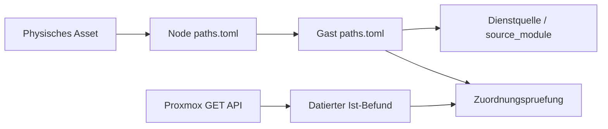

# Physische Architektur und digitaler Zwilling

Stand: 21.10.2026. Lesende Live-Pruefung; keine Cluster-Konfiguration geaendert.
Messzeitpunkt und Rohbefunde: [Cluster-Audit](assets/cluster-audit-2026-10-21.json).

## Entscheidung

Nicht noch eine manuell gepflegte VM-Tabelle und vorerst kein zusaetzliches CMDB-System.
Die bestehende Pfadbibliothek ist bereits der Kern eines kleinen digitalen Zwillings:



- [physical.toml](physical.toml): stabile Asset-IDs, Hardware und physische Abhaengigkeiten.
- [Root-Manifest](../paths.toml): aufloesbare Modulpfade, keine zweite VM-Datenbank.
- Node-Manifeste: Proxmox-Name und Management-IP.
- Gast-Manifeste: VMID/CTID, Node, dokumentierte Adresse, Diensttyp und Quellverweis.
- [cluster_audit.py](cluster_audit.py): verknuepft diese Daten und vergleicht sie mit Proxmox.
- Beobachtungen bleiben getrennt von Deklarationen. Migrationen werden gemeldet, nicht still in Soll-Daten uebernommen.

Asset-IDs wie `compute_ug` sind Inventarschluessel, keine Seriennummern. Nach
physischer Kennzeichnung sollten sie am Gehaeuse stehen. Standort, Steckdose/USV
und Switch-Port sind bewusst `unknown`: Ein Hostname beweist keine Etage.
Ein Hardwaretausch erzeugt kuenftig ein neues Asset; ein Node-Umzug nicht.

## Verifizierter Cluster

`brainhome`: fuenf Nodes online, fuenf Stimmen, Quorum drei, Transport knet.
25 Gaeste: 16 VMs und neun LXCs; 22 running, drei stopped.
Die deklarierte Platzierung aller 25 Gaeste und alle fuenf Management-IPs passen
zum Live-Bestand. IPs der Gaeste stammen aus Manifesten, nicht aus einem Netzscan.

| Node | Management-IP | CPU live | RAM nutzbar | RAM benutzt | PVE |
|---|---|---|---|---|---|
| proxmox-eg | 192.168.188.253 | Intel i7-9700, 8 Threads | 31,2 GiB | 31 % | 9.2.10 |
| proxmox-og | 192.168.188.252 | Intel i7-9700, 8 Threads | 31,2 GiB | 30 % | 9.2.10 |
| proxmox-ug | 192.168.188.248 | AMD FX-8350, API meldet 4 Threads | 23,4 GiB | 74 % | 9.2.10 |
| proxmox-ws | 192.168.188.247 | Ryzen 7 3800X, 16 Threads | 31,3 GiB | 86 % | 9.2.10 |
| proxmox-dt | 192.168.188.133 | Ryzen 5 3600, 12 Threads | 15,5 GiB | 82 % | 9.1.1 |

RAM-Werte sind eine Momentaufnahme inklusive Host-/Cache-Effekten, keine
Langzeitmessung. WS nutzt zusaetzlich etwa 4,1 GiB Swap; Ursache und aktive
Swap-I/O vor einer RAM-Aenderung messen. EG/OG sind Lenovo-DMI-Produkte
`10RRS1F802` / `10RS0033MX`; UG ist Gigabyte `GA-990FXA-UD3`, WS MSI `MS-7C37`.
Nicht ungeprueft als M920q/Tiny oder T-CPU klassifizieren.

| Node | VMs | LXCs |
|---|---|---|
| EG | 102 haos-eg, 108 openwrt-eg | 114 pihole-eg, 117 caddy-eg |
| OG | 103 haos-og, 109 openwrt-og | 111 pihole-og, 120 caddy-og |
| UG | 106 haos-ug, 115 haos-ga, 119 openwrt-ug, 219 grafana | 100 pihole, 110 caddy, 116 brainhome-prod, 130 pxe-stack |
| WS | 101 haos, 113 ubuntu-pc, 220 windows-stefan (gestoppt) | 112 brainhome-dev (gestoppt) |
| DT | 104 vaultwarden, 105 stalwart-mail, 107 idp-keycloak, 121 nextcloud-core, 180 coral-ai (gestoppt) | keine |

Der alte Host `.254` ist kein aktuelles Mitglied. Die im Maerz geplanten vier
neuen UG-Tinys sind kein Abbild dieses Bestands. WS ist bereits Ryzen, nicht FX.

## Risiken nach Prioritaet

1. **Wiederherstellbarkeit vor Ausbau.** In den beiden aktivierten Proxmox-
   Backup-Jobs fehlen 101, 102, 103, 104, 105, 106, 115, 180 und 220.
   Besonders Vaultwarden und Mail sowie alle fuenf HAOS-Instanzen pruefen.
   Separate HA-/Applikationsbackups wurden nicht untersucht. Konfigurierte Jobs
   beweisen weder erfolgreiche Backups noch eine gelungene Wiederherstellung.
2. **Gemeinsame Backup-Fehlerdomaene.** `backup-daily`, `backup-monthly` und
   `shared-storage` verweisen auf dasselbe NAS `.42`. Gemeldet sind rund
   3,50 TB von 3,93 TB belegt, etwa 89 %; die Anzeigen nicht dreimal addieren.
   Der Job fuer `backup-monthly` laeuft sonntags, nicht monatlich.
   Kein PBS-Storage ist registriert. Separates Backup-Ziel plus offline/offsite
   Kopie und regelmaessige Restore-Tests sind wichtiger als weitere Dienst-Nodes.
3. **HA ist selektiv.** Nur VM102, VM103 und VM106 sind HA-verwaltet.
   Es gibt einen konfigurierten Replikationsjob 102 von EG nach OG. Keine
   Aussage ueber dessen letzten Erfolg. Storage-Erreichbarkeit, CPU-Modell,
   Passthrough und Netzabhaengigkeiten pro Gast vor Failover testen.
   Corosync-Quorum bedeutet weder Dienst-HA noch Datenredundanz.
4. **Kapazitaet ungleich verteilt.** Erst WS-Speicherdruck messen und DT-RAM
   planen. EG/OG haben Reserve, aber diese nicht durch beliebige Verschiebungen
   kritischer Infrastruktur aufbrauchen. Intel-/AMD-Mischbetrieb und lokale
   Geraetebindungen verhindern pauschale Live-Migrationsversprechen.
5. **Versionsstand angleichen.** DT meldet PVE 9.1.1 / Kernel 6.17.2-1-pve,
   die vier anderen 9.2.10 / 7.0.14-11-pve. Wartungsfenster erst nach Backups
   und Release-/Kompatibilitaetspruefung; kein automatisches Upgrade.
6. **Widerspruechliche Planungen.** Alte Dokumente verwenden verschiedene
   VLAN-Nummern. Keine davon ungeprueft ausrollen. Zuerst IPAM/VLAN-Entscheidung
   festhalten. MAC-Zuweisung ist keine verlaessliche Identitaet; dynamische VLANs
   brauchen passende hostapd/RADIUS-/AP-Konfiguration. Eine SSID aendert man
   nicht fern durch blosses Zuweisen am Server.
7. **Zugangsdaten in Dokumentation.** Die Infrastruktur-Uebersicht enthaelt
   Zugangsdaten/Secrets. Als potenziell offengelegt behandeln, kontrolliert
   rotieren und anschliessend durch Secret-Referenzen ersetzen. Nicht in den
   digitalen Zwilling uebernehmen.

## Betrieb und Grenzen

Python 3.11+ mit Standardbibliothek; kein Paket und kein zusaetzlicher Dienst.
Vom Workspace-Root aus mit dem konfigurierten Interpreter ausfuehren:

```bash
python3 architektur/cluster_audit.py
python3 architektur/cluster_audit.py --live proxmox-ug --output /tmp/brainhome-audit.json
python3 architektur/cluster_audit.py --observed architektur/assets/cluster-audit-2026-10-21.json
python3 -m unittest discover -s architektur -p 'test_cluster_audit.py'
```

Fuer den Offline-Vergleich akzeptiert `--observed` den gesamten Bericht oder
nur dessen `observed`-Objekt. Exitcode 0: keine Platzierungsdrift; 1: Drift; 2: Fehler.
Backup-Luecken sind Befunde im JSON und kein Drift-Exitcode. Ohne Live-Option
findet ausschliesslich lokale Validierung statt. SSH nutzt BatchMode,
bekannte Hostschluessel und ausschliesslich `pvesh get`; keine Agent-Ausfuehrung,
Migration, Restart, Cron-Aenderung oder Hostschluessel-Uebernahme.

Der vorhandene [Inventar-Export](../tools/config/infrastructure-inventory.md)
hat zum Pruefzeitpunkt leere Node-/Gastlisten, weil lokal `pvesh` fehlt.
Er ist deshalb keine belastbare Clusterquelle. Der neue Pruefer ist ein
gezielter Prototyp fuer die spaetere Integration dieses SSH-Transports in den
bestehenden Inventory-Manager, nicht dessen Ersatz oder ein zweiter Scheduler.

Nicht untersucht: konkrete Switch-Verkabelung, USV/Stromkreise, SMART-Werte,
ZFS-Redundanz und Datentraeger von DT, letzte Backup-/Replikationserfolge,
Restore-Faehigkeit, Dienst-Endpunkte, DNS/VIP-Failover und reale VLANs.
DT ist per Cluster-API erreichbar; direkter SSH-Zugang war nicht verfuegbar.

## Naechster Ausbau

Der naechste sinnvolle Bildschirm im Admin-Panel waere kein weiterer Server-
Kachelblock, sondern eine **Ausfallansicht**: Hardware auswaehlen und betroffene
Gaeste, Dienste, Storage- und Stromabhaengigkeiten sehen. Erst fehlende physische
Kanten vor Ort erfassen; Auswirkungen nicht aus Hostnamen erraten.

Danach benoetigt das Modell Beziehungen wie `depends_on`, `backup_target`,
`power_domain`, `switch_port` und `recovery_class`. Bestehende Modulabhaengigkeiten
aus dem Registry-Inventar wiederverwenden. Mit einem getesteten Restore und
einer realen Fehlerdomaenenkarte wird aus einer huebschen Zeichnung eine
belastbare Betriebsgrundlage. NetBox erst erwaegen, wenn Ports, IPAM und mehrere
Standorte die einfache Git-Pflege tatsaechlich ueberfordern.